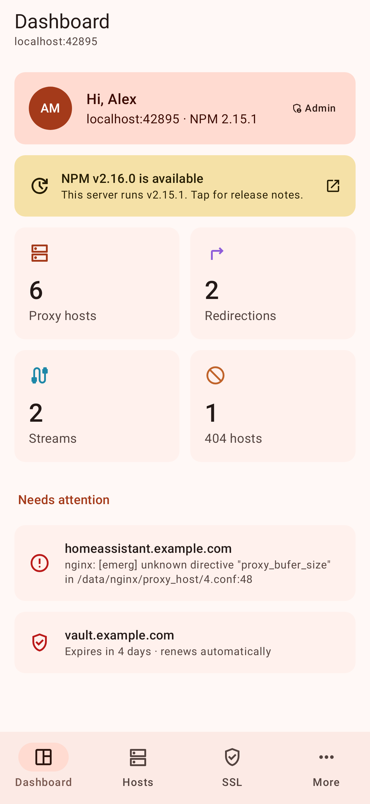
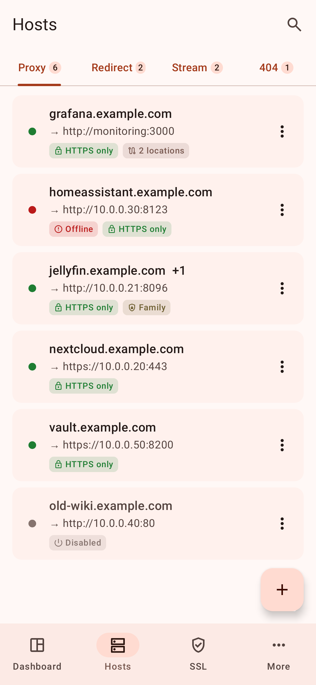
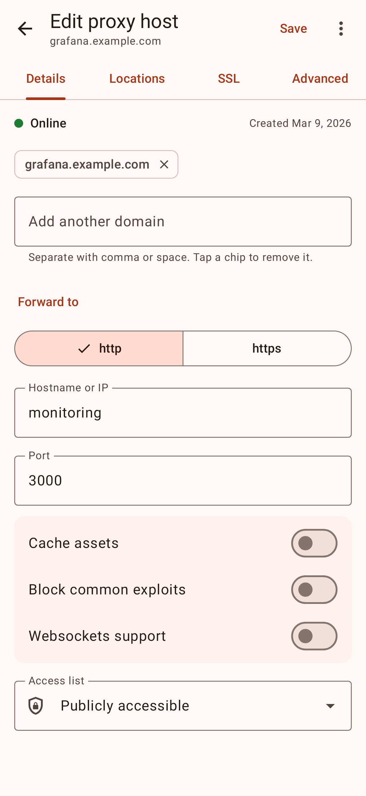
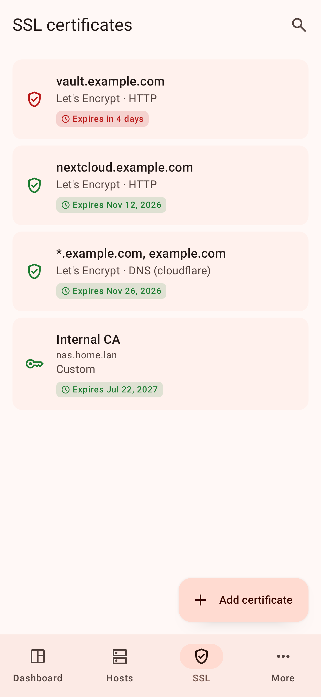
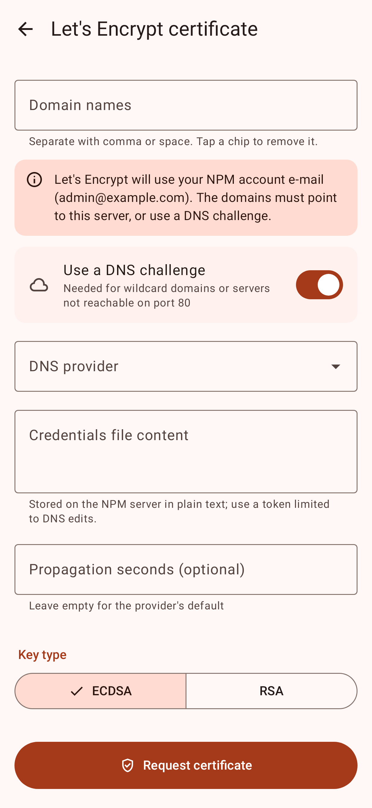
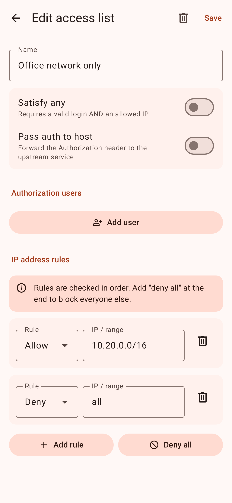
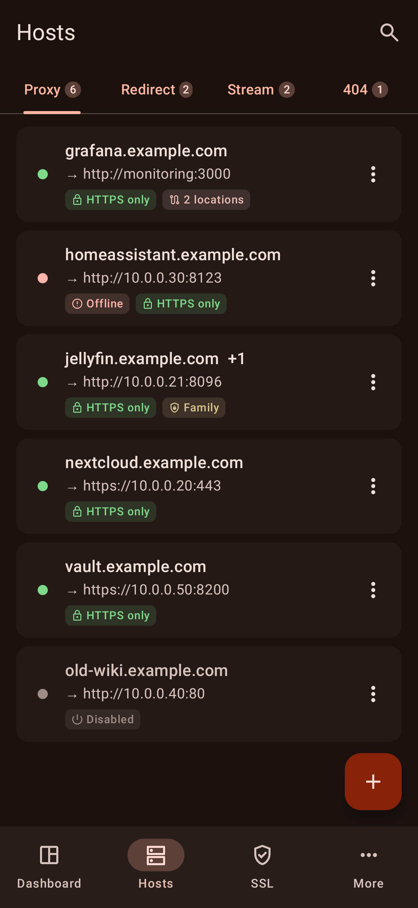
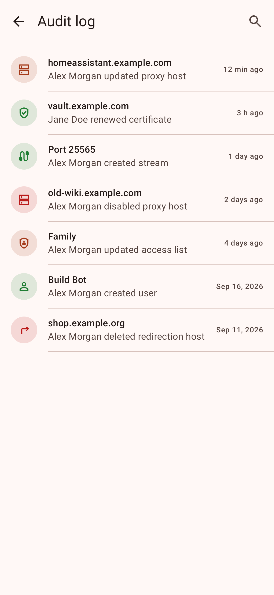

# NPM Mobile: an Android app for Nginx Proxy Manager

A **native** Android client for [Nginx Proxy Manager](https://nginxproxymanager.com) (NPM), written in Kotlin with
Jetpack Compose and Material 3. It isn't a web wrapper: the app talks to your NPM server's REST API directly, with
no cloud service in between and no tracking.

<p>
  
  
  
  
</p>
<p>
  
  
  
  
</p>

## Features

- **Dashboard:** host counts, NPM update notice, and a "needs attention" list (hosts whose nginx config failed,
  certificates expiring soon).
- **Proxy hosts:** create, edit, enable/disable and delete. Covers domains, scheme/host/port, caching, exploit
  blocking, websockets, access lists, custom locations, SSL (force SSL, HTTP/2, HSTS), and custom nginx config.
- **Redirection hosts, streams (TCP/UDP) and 404 hosts:** full management.
- **SSL certificates:** request Let's Encrypt certificates (HTTP or DNS challenge with any provider NPM supports,
  ECDSA/RSA), test domain reachability, renew, download, delete, and upload custom certificates with validation.
  Each certificate shows which hosts use it.
- **Access lists:** basic-auth users and allow/deny IP rules.
- **Users (admins):** create and edit users, roles, per-section permissions, and passwords.
- **Audit log** with filter and event details. **Default site** setting.
- **Your account:** profile, password change, **two-factor authentication** (QR code setup, backup codes); 2FA
  sign-in is supported.
- **Several servers:** save multiple NPM instances and switch between them.
- Sessions renew automatically. Optionally, "stay signed in" keeps your password encrypted to renew expired sessions.
- Search, pull-to-refresh, light/dark theme and Material You colors.
- Respects NPM permissions: users only see and change what their NPM account allows.

## Install

Download the APK from [Releases](https://github.com/revocx35/ngnix_proxy_manager_mobile/releases) and install it
(Android 8.0+). Then enter your NPM **admin** address, e.g. `npm.example.com` or `http://192.168.1.10:81`, and sign
in with your NPM account.

Tested against **Nginx Proxy Manager 2.15.1**. Other 2.x versions with the same API should work.

## Security

- Session tokens (and, only if you enable "stay signed in", your password) are encrypted with a key from the
  Android Keystore that never leaves the device. App backups are disabled.
- Plain HTTP is allowed for LAN addresses (NPM's admin UI usually runs on `http://…:81`). For HTTP to a public
  address the app warns you and asks for confirmation first.
- Certificates from user-installed CAs are trusted, so an admin UI behind a private CA works once the CA is
  installed on the phone.
- The app doesn't collect anything. Crash reports stay on the device until you copy them yourself.

## Building

Requirements: JDK 21 and the Android SDK (platform 37).

```sh
echo "sdk.dir=/path/to/android-sdk" > local.properties
./gradlew :core:test :app:testDebugUnitTest :app:lintDebug :app:assembleDebug
# APK: app/build/outputs/apk/debug/app-debug.apk
```

Live tests against a throwaway NPM in Docker:

```sh
scripts/dev-npm.sh up        # prints the NPM_IT_* variables to export
./gradlew :core:test :app:testDebugUnitTest
scripts/dev-npm.sh down
```

The design, the NPM API details the app relies on, and the test strategy are in [ARCHITECTURE.md](ARCHITECTURE.md).

## Disclaimer

This is an unofficial app, not affiliated with or endorsed by the Nginx Proxy Manager project.

## License

MIT. See [LICENSE](LICENSE). Icons are Material Symbols by Google (Apache 2.0).
